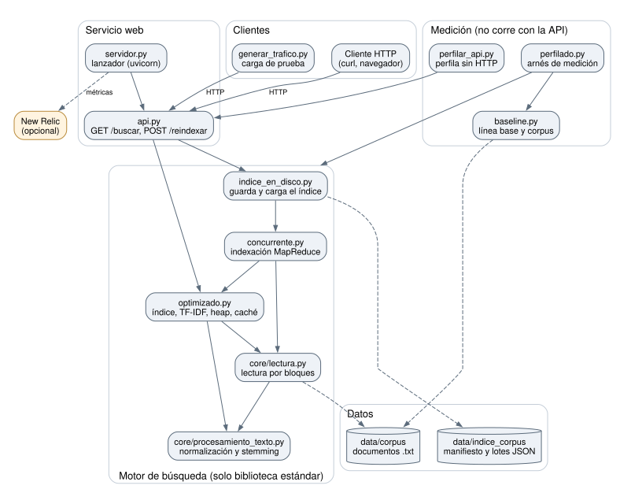

# Arquitectura

El sistema tiene dos partes: un **motor de búsqueda** que usa solo la biblioteca estándar y un **servicio web** que lo expone por HTTP. Las herramientas de medición usan esas mismas piezas, pero no forman parte del servicio.

## Diagrama de componentes

Las flechas continuas son las dependencias principales y las llamadas HTTP; la lista completa está en [Dependencias entre módulos](#dependencias-entre-módulos). Las punteadas indican lectura o escritura de datos y el envío opcional de métricas a New Relic. El diagrama se genera desde [`docs/diagramas/arquitectura.dot`](https://github.com/JoniMora/pef-26/blob/master/docs/diagramas/arquitectura.dot) con `make diagrama`.

## Módulos y responsabilidades

| Módulo | Parte | Responsabilidad |
| :--- | :--- | :--- |
| [`core/procesamiento_texto.py`](https://github.com/JoniMora/pef-26/blob/master/src/core/procesamiento_texto.py) | Motor | Normalización, *stemming* y tokenización. |
| [`core/lectura.py`](https://github.com/JoniMora/pef-26/blob/master/src/core/lectura.py) | Motor | Lectura de documentos por bloques de tamaño fijo, sin cargar cada archivo entero en memoria. |
| [`optimizado.py`](https://github.com/JoniMora/pef-26/blob/master/src/optimizado.py) | Motor | Índice invertido, ranking TF-IDF con *heap* y caché de consultas. |
| [`concurrente.py`](https://github.com/JoniMora/pef-26/blob/master/src/concurrente.py) | Motor | Construcción del índice en paralelo, como un MapReduce sobre procesos. |
| [`indice_en_disco.py`](https://github.com/JoniMora/pef-26/blob/master/src/indice_en_disco.py) | Motor | Guarda el índice en disco por lotes y lo carga al arrancar. |
| [`api.py`](https://github.com/JoniMora/pef-26/blob/master/src/api.py) | Servicio | API web con FastAPI: `GET /buscar` y `POST /reindexar`. |
| [`servidor.py`](https://github.com/JoniMora/pef-26/blob/master/src/servidor.py) | Servicio | Levanta la API con uvicorn y, si hay licencia, con el agente de New Relic. |
| [`baseline.py`](https://github.com/JoniMora/pef-26/blob/master/src/baseline.py) | Medición | Búsqueda secuencial por fuerza bruta, la línea base. También genera el corpus sintético. |
| [`perfilado.py`](https://github.com/JoniMora/pef-26/blob/master/src/perfilado.py) | Medición | Arnés de medición y perfilado de las cinco versiones. |
| [`generar_trafico.py`](https://github.com/JoniMora/pef-26/blob/master/src/generar_trafico.py) | Medición | Generador de carga para la API, con p50, p95 y p99 por tipo de consulta. |
| [`perfilar_api.py`](https://github.com/JoniMora/pef-26/blob/master/src/perfilar_api.py) | Medición | Hace en un solo proceso el trabajo de la API bajo carga, para perfilarlo con cProfile y Scalene. |
| [`scripts/medir_recarga.py`](https://github.com/JoniMora/pef-26/blob/master/scripts/medir_recarga.py) | Medición | Mide de qué se compone una recarga del índice. |
| [`scripts/control_rendimiento.py`](https://github.com/JoniMora/pef-26/blob/master/scripts/control_rendimiento.py) | Medición | Los controles de benchmark, profiling y memoria del CI. |
| [`benchmarks/`](https://github.com/JoniMora/pef-26/tree/master/benchmarks) | Medición | Las operaciones que mide el benchmark. |

La referencia de cada función, generada desde los docstrings, está en [Módulos](api/modules).

## Dependencias entre módulos

Los módulos de `src/` se importan entre sí como *top-level*, sin formar un paquete, porque los scripts se ejecutan directamente.

| Módulo | Depende de |
| :--- | :--- |
| `core.procesamiento_texto` | — |
| `core.lectura` | `core.procesamiento_texto` |
| `optimizado` | `core.lectura`, `core.procesamiento_texto` |
| `concurrente` | `optimizado`, `core.lectura` |
| `indice_en_disco` | `concurrente` |
| `api` | `optimizado`, `indice_en_disco` |
| `servidor` | `api`, que uvicorn carga por nombre al arrancar |
| `baseline` | — |
| `generar_trafico` | `baseline`, solo por el vocabulario del corpus |
| `perfilar_api` | `api`, `generar_trafico`, `optimizado` |
| `perfilado` | `baseline`, `optimizado`, `concurrente`, `core.procesamiento_texto` |

Las dependencias van en un solo sentido, de la API hacia el procesamiento de texto, y no hay ciclos. `baseline` no usa el procesamiento de texto a propósito: es la versión ingenua contra la que se mide ([Refactorización](mantenimiento.md#refactorización)).

## Dependencias externas

| Componente | Dependencia | Archivo |
| :--- | :--- | :--- |
| Motor (`core`, `baseline`, `optimizado`, `concurrente`, `indice_en_disco`) | Ninguna: solo la biblioteca estándar. | — |
| Servicio web | FastAPI, uvicorn y Starlette. | [`requirements.txt`](https://github.com/JoniMora/pef-26/blob/master/requirements.txt) |
| Monitoreo | Agente de New Relic, opcional. | [`requirements-apm.txt`](https://github.com/JoniMora/pef-26/blob/master/requirements-apm.txt) |
| Generador de carga y tests | `httpx2` y las herramientas de calidad. | [`requirements-dev.txt`](https://github.com/JoniMora/pef-26/blob/master/requirements-dev.txt) |
| Medición | line_profiler, memory-profiler, Scalene, SnakeViz y matplotlib. | [`requirements-perfilado.txt`](https://github.com/JoniMora/pef-26/blob/master/requirements-perfilado.txt) |
| Informes | ReportLab y Pillow. | [`requirements-informes.txt`](https://github.com/JoniMora/pef-26/blob/master/requirements-informes.txt) |

## Flujo de una consulta

1. `GET /buscar` llega a `api.py`, que valida los parámetros con FastAPI.
2. `ServicioDeBusqueda` compara la fecha de modificación del directorio del corpus con la del índice en uso. Si cambió, o si todavía no hay índice, pide uno a `indice_en_disco.obtener_indice()`.
3. `obtener_indice()` carga el índice guardado si sigue siendo válido. Si no, lo construye con `concurrente.construir_indice()` y guarda cada lote apenas termina.
4. `Buscador.buscar()` normaliza la consulta a su forma canónica y busca el resultado en la caché.
5. Si no está en la caché, `optimizado.buscar()` interseca las *postings lists* y `rankear()` selecciona los `k` mejores por TF-IDF con un *heap*.
6. La API responde con el total de coincidencias y el ranking, en JSON.

## Flujo de una recarga

`POST /reindexar` hace el paso 3 sin mirar el índice guardado: reconstruye siempre y reemplaza el `Buscador`, con su caché vacía. Un `Lock` evita que dos recargas o dos consultas construyan el índice a la vez. Mientras se construye el nuevo, el índice anterior sigue en memoria, y por eso el pico de RAM más que se duplica ([Monitoreo con New Relic](rendimiento.md#monitoreo-con-new-relic)).

## Datos en disco

| Ubicación | Contenido | ¿Se versiona? |
| :--- | :--- | :--- |
| `data/corpus/` | Documentos `.txt` del corpus sintético. | No: se genera con `baseline.py --generar`. |
| `data/indice_corpus/` | Índice guardado: `manifiesto.json` y un `lote_NNN.json` por lote. | No: se reconstruye. |
| `profiles/` | Salidas de los perfiladores. | No: se regeneran. |
| `reportes/` | Reportes de los controles: seguridad, secretos y rendimiento. | No: se regeneran, y el CI los guarda como artefacto. |
| `docs/perfilado-capturas/`, `docs/newrelic-capturas/` | Capturas e informes que se entregan. | Sí. |

El MapReduce de la indexación y el formato del índice guardado se explican en [Diseño técnico](diseno-tecnico.md#arquitectura-mapreduce-sobre-particiones-del-corpus).
