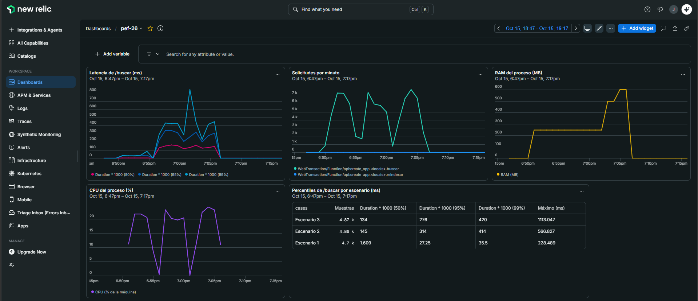

# Rendimiento

Las métricas de esta sección **no se estiman ni se derivan teóricamente**: se obtienen exclusivamente mediante herramientas de perfilado formales, sobre el mismo corpus, la misma máquina y el mismo conjunto de consultas de prueba.

## Resumen

| Comparación | Antes | Después | Mejora |
| :--- | ---: | ---: | ---: |
| Consulta, línea base contra índice invertido | 2.345 ms | 8,27 ms | **284×** |
| Consulta repetida, con caché caliente | 2.345 ms | 0,0021 ms | **≈1.130.000×** |
| Indexación, secuencial contra paralela | 8.596 ms | 4.841 ms | **1,78×** |
| Pico de memoria al leer un archivo de 21 MB | 279 MB | 1,1 MB | **254×** |

El costo de estas mejoras es memoria y un arranque más lento: ver [Consumo de memoria](#consumo-de-memoria) y el [punto de equilibrio](#las-cinco-preguntas-de-la-medición).

## Complejidad temporal

`n` = documentos, `m` = tokens promedio por documento, `N` = tokens del corpus, `r` = candidatos, `k` = resultados pedidos, `t` = términos de la consulta, `P` = procesos, `V` = vocabulario. La justificación de cada cota está en [Diseño técnico](diseno-tecnico.md).

| Operación | Línea base | Optimizado |
| :--- | :--- | :--- |
| Resolver una consulta | O(n · m) | O(t) promedio para ubicar los términos |
| Combinar términos | — | O(min(\|A\|, \|B\|)) por intersección |
| Ranking | Sin ranking | O(r · log k), contra O(r · log r) con `sorted()` |
| Indexación | Sin costo | O(N) una sola vez |
| Indexación paralela | — | *Map* O(N / P), *Reduce* O(V · P · 4) |
| Lecturas de disco | O(n) en cada consulta | Una sola vez, al indexar |

## Consumo de memoria

| Qué se mide | Valor | Herramienta |
| :--- | ---: | :--- |
| Línea base, RSS | 38,2 MB | Proceso limpio por versión ([comparativa](#comparación-de-las-cinco-versiones)) |
| Índice invertido en proceso, RSS | 184,1 MB | Ídem |
| Índice paralelo, RSS con los parciales en vuelo | 329,1 MB | Ídem |
| Índice invertido en sí | 132,2 MB | `tracemalloc` |
| Memoria auxiliar del ranking, `k` = 10 con 200.000 candidatos | 2.832 B | `tracemalloc` |
| Memoria auxiliar del ranking, `k` = 100 con 200.000 candidatos | 22.736 B | `tracemalloc` |
| API con el índice cargado, pico | 274 MB | Scalene |
| API durante una recarga del índice, pico | ~590 MB | New Relic |

## Instrumental de medición

| Dimensión | Herramienta | Uso |
| :--- | :--- | :--- |
| CPU (determinista) | **`cProfile` + `pstats`** | Costo acumulado por función; identificación de *hotspots*. |
| CPU (visualización) | **`snakeviz`** | Inspección jerárquica del grafo de llamadas. |
| CPU (línea a línea) | **`line_profiler`** (`@profile`) | Costo por línea dentro de los *hotspots* detectados. |
| Tiempo de pared | **`timeit`** / `time.perf_counter()` | Latencia de consulta; mínimo de N repeticiones. |
| Memoria (asignaciones) | **`tracemalloc`** | Pico de memoria y atribución por línea de código. |
| Memoria (residente) | **`memory_profiler`** | Evolución del RSS a lo largo de la corrida, con `include_children`. |
| CPU + memoria por línea | **`Scalene`** | Separa tiempo de Python del nativo y atribuye memoria por línea. |

cProfile, line_profiler, memory_profiler y Scalene están orquestadas por [`src/perfilado.py`](https://github.com/JoniMora/pef-26/blob/master/src/perfilado.py), que además produce la tabla comparativa, los gráficos y el reporte HTML. No reemplaza a las herramientas: las invoca, recolecta sus salidas en `profiles/` y deja los archivos crudos (`.prof`, `.json`, `.txt`) para inspección manual.

## Protocolo de medición

- **Corpus:** idéntico en todas las corridas; se documentan cantidad de documentos y tamaño total en disco.
- **Repeticiones:** 10 corridas por versión; se reporta la **mediana** para descartar valores atípicos.
- **Caché de sistema operativo:** se descartan las corridas hasta alcanzar el régimen estacionario. Una única corrida de calentamiento resultó **insuficiente**: sobre este corpus hicieron falta **3 corridas** para que el *page cache* se estabilizara (13.570 → 14.040 → 10.795 ms, y recién a partir de la cuarta ~2.450 ms). Se reporta la mediana del régimen estacionario y se declara además el rango frío.
- **Orden de las corridas:** las versiones se miden **alternadas** dentro de cada ronda (secuencial → `P = 4` → `P = 2` → repetir), nunca en bloques. Medirlas en bloque produjo un *speedup* aparente de 5,63× que era un artefacto del *page cache*; ver [Resultados de la paralelización](#resultados-de-la-paralelización).
- **Aislamiento:** las mediciones de tiempo se toman **sin** el perfilador activo, dado que `cProfile` introduce sobrecarga; el perfilador se usa para atribuir costo, no para cronometrar. Esto incluye a `tracemalloc`, que es un perfilador de asignaciones: activarlo durante el cronometrado inflaba la consulta **3,3×** y la indexación **23 %**, de modo que la atribución de memoria corre en una pasada aparte.
- **Un proceso limpio por versión:** cada versión se mide en un intérprete nuevo. Compartiendo proceso, la primera en construir el índice fijaba el pico de RSS para todas las demás y las cifras dejaban de ser atribuibles.
- **Métricas separadas:** se registran por separado el **tiempo de construcción del índice** (costo único) y el **tiempo de consulta** (costo recurrente).

## Resultados

Consulta de referencia: `"algoritmo"` sobre 50.000 documentos (47.797 coincidencias).

| Versión | Tiempo por consulta (ms) | Costo único de indexación (ms) | Pico de memoria (MB) | Observaciones |
| :--- | ---: | ---: | ---: | :--- |
| Inicial (Baseline) | **2.485** | — | 18,3 | Mediana de 10 corridas en régimen estacionario (min 2.408 / max 2.569, ±3 %). Con *page cache* frío: **10.795–14.040 ms**. Lectura completa del corpus en cada consulta; sin ranking. |
| Estructura + Algoritmo Optimizado | **9,06** | 8.607 | 177,7 | Mediana de 10 consultas con caché forzada a fallo. Índice invertido + intersección de `set` + ranking TF-IDF en O(k) con `heapq.nlargest`. |
| ↳ *con acierto de caché* | **0,0020** | — | — | Misma consulta repetida sobre el mismo proceso (`QueryCache`). |
| Concurrente (`P = 4`) | *sin cambio* | **4.689** | 323,6 | MapReduce con `ProcessPoolExecutor` sobre 16 lotes. Solo cambia la indexación: la consulta usa el mismo `Buscador`, de modo que su tiempo es el de la fila anterior por construcción. |

> **Corrección respecto de la medición previa.** El costo de indexación de la versión optimizada figuraba como **33.225 ms**. Ese valor corresponde al **régimen frío**, no al estacionario que el protocolo exige: remedido con el corpus residente en *page cache* son **8.607 ms**. La cifra vieja no era incorrecta como observación, pero estaba mal etiquetada, y comparar contra ella habría inflado el *speedup* del incremento 4 de 1,84× a 5,6×.

## Comparación de las cinco versiones

Producida por `python3 src/perfilado.py --comparativa`. Es una campaña de medición **independiente** de la tabla anterior: corpus de 50.000 documentos, mediana de 3 rondas alternadas tras descartar una de calentamiento, cada versión en un proceso limpio.

| Versión | Tiempo de consulta | Costo de indexación | Memoria (RSS) | Observación |
| :--- | ---: | ---: | ---: | :--- |
| Implementación inicial | 2.345 ms | — | 38,2 MB | Baseline — escaneo secuencial O(n·m) |
| Estructura optimizada | 100,98 ms | 8.744 ms | 192,3 MB | Mejora de búsqueda — índice invertido + `set`, ranking con `sorted()` |
| Algoritmo optimizado | 8,27 ms | 8.596 ms | 184,1 MB | Mejor escalabilidad — heap top-k + caché LRU |
| Concurrencia/paralelismo | 7,95 ms | 4.841 ms | 329,1 MB | Evaluar overhead — MapReduce sobre `ProcessPoolExecutor` |
| Versión final | 0,0021 ms | 4.697 ms | 327,5 MB | Resultado final — indexación paralela + caché caliente |

> **Sobre la fila "Estructura optimizada".** No corresponde a un archivo: es la etapa intermedia en que ya existen el índice invertido y el `set`, pero todavía no el heap ni la caché. Se mide ejercitando `_rankear_sorted()` —la implementación que `rankear()` reemplazó, conservada en `src/perfilado.py`— sobre el mismo índice, de modo que la diferencia contra la fila siguiente aísle el efecto del heap y nada más.
>
> Las cifras concuerdan con la tabla anterior dentro de la varianza entre campañas (indexación 8.596 contra 8.607 ms; consulta 8,27 contra 9,06 ms). La diferencia de RSS —184,1 contra 177,7 MB— es el costo del arnés de medición, que mantiene la lista de archivos y el `Buscador` vivos mientras muestrea.

**Las cinco versiones devuelven 47.797 coincidencias**, que es el testigo de equivalencia exigido: la optimización no cambió el resultado, solo el costo de obtenerlo.

## Las cinco preguntas de la medición

Las respuestas se derivan de los números medidos, no de la teoría; `src/perfilado.py` las genera a partir del JSON de resultados.

**¿Dónde está el principal cuello de botella?** En la línea base, releer y escanear el corpus en cada consulta: 2.345 ms por búsqueda, de los cuales `cProfile` atribuye **2,07 s de 2,87 s a `read()`** — E/S pura. Introducido el índice, el cuello se **desplaza** al costo único de indexación, y dentro de él a la tokenización: `optimizado.py:115(tokenizar)` acumula 0,85 s de 1,37 s.

**¿Qué optimización se realizó?** Cuatro incrementos acumulativos: índice invertido con `dict` más intersección de `set`; ranking top-k con `heapq.nlargest` en O(r·log k) y caché LRU; indexación MapReduce sobre `ProcessPoolExecutor`; y la combinación de ambas.

**¿Qué impacto tuvo?** La consulta pasa de 2.345 ms a 8,27 ms (**284×**) y a 0,0021 ms con caché caliente (**≈1.130.000×**). El heap por sí solo lleva la resolución de 100,98 ms a 8,27 ms (**12,2×**). La indexación paralela baja de 8.596 ms a 4.841 ms (**1,78×**).

**¿La mejora se mantiene al aumentar el volumen?** Sí, y se **amplifica** — pero no todas por igual:

| Métrica | 5.000 docs | 50.000 docs | Tendencia |
| :--- | ---: | ---: | :--- |
| Consulta — inicial | 280,22 ms | 2.321,54 ms | Crece con el corpus: O(n·m) |
| Consulta — estructura (`sorted`) | 6,12 ms | 100,98 ms | Crece **16,5×** ante 10× de datos |
| Consulta — algoritmo (heap) | 1,55 ms | 8,34 ms | Crece solo **5,4×** |
| Consulta — final (caché) | 0,004 ms | 0,002 ms | Plana: independiente del volumen |
| Ventaja indexada sobre baseline | 181× | **278×** | Se amplifica |
| *Speedup* del paralelismo | 1,54× | **1,82×** | Se amplifica |

El dato más interesante es la separación entre `sorted()` y el heap: con 10× de datos, la versión con `sorted()` se degrada tres veces más rápido que la del heap. La ventaja del heap **no es constante, crece con el volumen**, que es exactamente lo que promete O(r·log k) frente a O(r·log r). El paralelismo también mejora con el tamaño, por la razón opuesta: el costo fijo de levantar los procesos solo se amortiza cuando hay trabajo suficiente.

**¿Qué trade-off se produjo?** Memoria y arranque a cambio de latencia. El RSS sube de 38,2 MB a 184,1 MB con el índice (**4,8×**) y a 329,1 MB con los procesos (**1,79×** adicional por los índices parciales en vuelo). Además hay un costo único de indexación de 4.697 ms que la línea base no paga: el **punto de equilibrio está en ~3 consultas**.

**Lectura de los resultados**

| Comparación | Factor |
| :--- | ---: |
| Consulta indexada vs. línea base | **274×** más rápida (2.485 → 9,06 ms) |
| Consulta cacheada vs. línea base | **≈1.264.000×** más rápida (2.485 → 0,0020 ms) |
| Costo de memoria | **9,7×** más (18,3 → 177,7 MB) |
| Indexación paralela vs. secuencial | **1,84×** más rápida (8.607 → 4.689 ms), a costa de **1,8×** de memoria (177,7 → 323,6 MB) |

El intercambio es explícito y es el punto central del trabajo: **se compra tiempo con memoria y con un costo único de arranque.** La indexación cuesta 8,6 s en régimen estacionario, y cada consulta ahorra 2.476 ms respecto de la línea base: el **punto de equilibrio está en ~4 consultas** (8.607 / 2.476). Con la indexación paralela baja a **~2** (4.689 / 2.476). Por debajo de eso la línea base gana; por encima, la diferencia crece sin cota. Para un motor de búsqueda —donde el índice se construye una vez y se consulta indefinidamente— el intercambio es favorable por varios órdenes de magnitud.

**Efecto del ranking en O(k).** Reescribir `rankear()` para puntuar al vuelo no solo acotó la memoria: también resultó **más rápido** que la versión con `dict scores`. La primera implementación en O(k) usaba un generador anidado por candidato (`sum(... for ... in pesos)`) y costaba 29,5 ms; desdoblarlo en un bucle explícito con atajo para el caso de un solo término lo llevó a 7,6 ms sobre el mismo índice.

| Implementación de `rankear` | Memoria auxiliar | Tiempo (1 término) | Tiempo (4 términos) |
| :--- | :--- | ---: | ---: |
| `dict scores` + `nlargest(key=...)` | O(r) | 11,86 ms | 24,43 ms |
| Generador anidado + `nlargest` | O(k) | 29,53 ms | 38,91 ms |
| **Bucle explícito + `nlargest`** | **O(k)** | **7,60 ms** | **22,07 ms** |

La lección es que la cota de memoria y la velocidad no estaban en conflicto: el costo de la versión intermedia no venía del *streaming* sino de crear ~48.000 objetos generador, uno por candidato.

**Escalado con la cantidad de términos** (consultas con fallo de caché, mediana de 10):

| Consulta | Términos | Coincidencias | Tiempo (ms) |
| :--- | ---: | ---: | ---: |
| `algoritmo` | 1 | 47.797 | 9,06 |
| `algoritmo estructura` | 2 | 45.892 | 17,45 |
| `algoritmo estructura datos python` | 4 | 44.107 | 28,51 |
| `xyzinexistente` | 1 | 0 | **0,003** |

El crecimiento es lineal en la cantidad de términos, no en el tamaño del corpus. El último caso es el más ilustrativo: un término ausente del índice se resuelve con un fallo de `dict` y retorno inmediato en **3 microsegundos**, mientras que la línea base necesita leer los 50.000 archivos —**2.485 ms**— para llegar a la misma conclusión. Es un factor de **~800.000×** sobre el peor caso relativo de la implementación ingenua.

**Cómo se obtuvieron los valores**

- **Tiempo (línea base):** `time.perf_counter()` alrededor de `busqueda_secuencial()`, 10 repeticiones tras estabilizar el *page cache*; se reporta la mediana.
- **Tiempo (optimizado):** índice construido una sola vez; luego 10 repeticiones por consulta reinicializando `QueryCache` antes de cada una para forzar el fallo y medir el costo real de resolución. La fila de acierto se mide sobre 1.000 repeticiones consecutivas sin reinicializar.
- **Memoria (línea base):** pico de *resident set size* vía `/usr/bin/time -l` (19.165.184 bytes = 18,3 MB). El bajo consumo es consistente con el análisis O(m): mantiene un solo documento en memoria por vez, a costa de releer todo el corpus.
- **Memoria (concurrente):** pico de RSS vía `/usr/bin/time -l` (339.337.216 bytes = **323,6 MB**). El sobrecosto de 1,8× no es el índice —que es el mismo objeto que en la versión secuencial— sino los **parciales en vuelo**: mientras el padre fusiona, conviven el índice global ya poblado y los índices parciales todavía no liberados, sumado al espacio propio de cada intérprete hijo. Es el precio de memoria del paralelismo y escala con `P`, no con el corpus.
- **Memoria (optimizado):** pico de RSS vía `/usr/bin/time -l` (186.318.848 bytes = 177,7 MB). De ese total, `tracemalloc` atribuye **132,2 MB al índice invertido en sí**; el resto corresponde al intérprete, a la lista de 50.000 objetos `Path` y a los picos transitorios de decodificación. La memoria auxiliar del ranking no participa de este pico: es O(k), del orden de los kilobytes.

> La consulta de 4 términos pasó de 42.787 a **44.107** coincidencias respecto de la medición anterior. No es ruido: al corregirse el *stemmer*, `datos` dejó de indexarse como `dat` y se fusionó con `dato` (df = 49.702), de modo que la intersección AND ahora incluye los documentos que solo contenían la forma singular.

## Resultados de la paralelización

Mediana de 6 corridas por configuración sobre 50.000 documentos, **alternando** las versiones dentro de cada ronda y descartando 2 rondas de calentamiento:

| Configuración | Mediana (ms) | min / max | *Speedup* | Eficiencia |
| :--- | ---: | ---: | ---: | :--- |
| Secuencial (`optimizado.py`) | 8.607 | 8.477 / 8.667 | 1,00× | — |
| `--workers 2` | 5.189 | 5.104 / 5.269 | **1,66×** | 83 % sobre 2 núcleos físicos |
| `--workers 4` | 4.689 | 4.660 / 4.759 | **1,84×** | 92 % sobre físicos — 46 % sobre lógicos |

La varianza es inferior al 3 % en las tres configuraciones. El resultado valida la predicción del diseño: pasar de `P = 2` a `P = 4` mejora el *speedup* solo un **11 %** (1,66× → 1,84×), porque los 4 procesadores lógicos son 2 núcleos físicos con *Hyper-Threading* y la carga es CPU-bound.

**Conservación del trabajo.** Un lote aislado (1/16 del corpus) cuesta 487 ms; los 16 lotes suman 7.792 ms, el **92 %** del costo secuencial de 8.478 ms. El 8 % restante es el arranque del pool, la serialización de los parciales y la fusión: el paralelismo no crea trabajo nuevo de forma significativa.

**Advertencia metodológica: el *page cache* cambia el resultado por un factor de 3.**

| Régimen | Secuencial | `--workers 4` | *Speedup* observado |
| :--- | ---: | ---: | ---: |
| Frío (corpus fuera de *page cache*) | 27.608–34.151 ms | 5.051–7.229 ms | **≈5,6×** |
| Estacionario (corpus residente) | 8.607 ms | 4.689 ms | **1,84×** |

La primera tanda de mediciones se tomó en bloques —10 corridas secuenciales, después 10 paralelas— y arrojó un *speedup* de **5,63×** sobre una máquina de 2 núcleos físicos. Un resultado superlineal es la señal de que se está midiendo otra cosa: el bloque secuencial corrió con el corpus fuera de caché y el paralelo, ya caliente.

El mecanismo es la **latencia de E/S por archivo**, no la CPU. Leer los 50.000 archivos en frío, sin tokenizar nada, cuesta **18.193 ms** —0,36 ms por archivo— contra 2.234 ms en caliente. Un solo proceso paga esa latencia en serie; cuatro procesos emiten lecturas simultáneas y la ocultan. La aceleración en frío es real y es un beneficio genuino del diseño, pero **no es *speedup* de paralelización de CPU** y reportarla como tal sería engañoso. De ahí que el protocolo pase a alternar las versiones dentro de cada ronda.

**Hipótesis descartada.** Se sospechó del *garbage collector*: un proceso secuencial que acumula ~2 millones de entradas podría estar pagando barridos generacionales que los workers, con 1/16 de los datos, evitan. Se midió con `gc.disable()` y la diferencia es de **0,4 %** (8.478 ms contra 8.447 ms). El GC no participa del efecto.

## Escalabilidad por hardware

Las mediciones anteriores varían el **volumen de datos**. Esta varía la **máquina**: el mismo código, el mismo tamaño de corpus y las mismas consultas, corridos en un equipo de gama alta seis años más nuevo y con seis veces más núcleos.

| Parámetro | Equipo A | Equipo B |
| :--- | :--- | :--- |
| CPU | Intel Core i5-7267U @ 3,10 GHz (2017) | AMD Ryzen 9 9900X (2024) |
| Núcleos | 2 físicos / 4 lógicos | **12 físicos / 24 lógicos** |
| RAM | 8 GB | 32 GB |
| Sistema Operativo | macOS 13.7.8 | Windows |

Mediana de 2 vueltas en régimen estacionario, tras descartar una vuelta de calentamiento:

| Medición | Equipo A | Equipo B | Ventaja de B |
| :--- | ---: | ---: | ---: |
| **Búsqueda sin índice** | 2.345 ms | 2.362 ms | **ninguna** |
| Indexación secuencial | 8.702 ms | 5.188 ms | 1,68× |
| Consulta indexada | 8,27 ms | 3,39 ms | 2,44× |
| Indexación paralela `P = 2` | 5.189 ms — 1,66× | 2.932 ms — 1,77× | 1,77× |
| Indexación paralela `P = 4` | 4.679 ms — 1,86× | 1.872 ms — 2,80× | 2,50× |
| Indexación paralela `P = 12` | — | 1.146 ms — 4,54× | — |
| Indexación paralela `P = 24` | — | 1.063 ms — 4,86× | — |

**La línea base no mejora.** Es el resultado que más dice de todo el trabajo: 2.345 contra 2.362 ms, un empate técnico —el equipo nuevo es incluso un 0,7 % más lento—. Seis veces más núcleos, siete años de arquitectura y un NVMe moderno no compran **nada** sobre una búsqueda secuencial monohilo. Coincide con lo que ya mostraba `cProfile`, donde `read()` se lleva 2,07 s de 2,87 s. La conclusión práctica es que **la optimización tenía que ser algorítmica**: ningún hardware arregla un O(n·m) que además está limitado por latencia de E/S por archivo.

**El SMT no rinde en ninguna de las dos.** Pasar de `P = 12` a `P = 24` en el equipo B aporta apenas **7 %** (4,54× → 4,86×), el mismo orden que el 11 % que aporta pasar de `P = 2` a `P = 4` en el equipo A. Dos máquinas, dos fabricantes, dos sistemas operativos y la misma física: los hilos lógicos no agregan unidades de ejecución para una carga CPU-bound.

**El techo de Amdahl difiere entre las máquinas.** Despejando la fracción serial a partir de los *speedups* medidos, el equipo A arrastra ~40 % de costo no paralelizable contra ~15 % del equipo B. Por eso A satura en 1,86× y B llega a 4,86×. La explicación más probable es la E/S —un NVMe moderno absorbe 24 lectores concurrentes; un SSD de 2017 no—, pero conviene declararlo como lo que es: una **inferencia del modelo**, no una medición directa del reparto en el equipo B.

**El costo del arranque en frío es de otro orden en Windows.** La primera vuelta del equipo B midió **168.799 ms** en la línea base: **71×** su propio régimen estacionario, contra el factor 4–6× que sufre el equipo A. La causa más probable es el antivirus escaneando 50.000 archivos recién creados en su primer acceso. Es la justificación más contundente del protocolo de descartar corridas de calentamiento: con una sola vuelta, la comparación habría sido 168 segundos contra 2,3.

> **Los corpus no son el mismo.** `generar_corpus_prueba()` usa `random` sin semilla fija, así que cada equipo sorteó su propio corpus: 47.753 coincidencias en B contra 47.797 en A, con distintos `doc_id` y *scores*. Mismo generador, mismo tamaño y misma distribución, pero **no los mismos documentos**. Es suficiente para comparar tiempos y no lo es para comparar resultados documento a documento; fijar una semilla queda como deuda pendiente.
>
> La verificación `Índices idénticos: True` dio positiva en las **12 corridas** del equipo B. Vale como validación cruzada del diseño concurrente en Windows, donde `spawn` es el método de arranque nativo y no una particularidad de macOS — que es exactamente el escenario que motiva la guarda `if __name__ == "__main__":`.

## *Hotspots* de la línea base

Salida de `cProfile` ordenada por tiempo acumulado (corrida instrumentada, 23,1 s por la sobrecarga del perfilador):

```text
   ncalls  tottime  percall  cumtime  percall filename:lineno(function)
        1    0.717    0.717   23.112   23.112 src/baseline.py:71(busqueda_secuencial)
    50000   16.008    0.000   16.434    0.000 {method 'read' of '_io.TextIOWrapper'}
    50000    4.307    0.000    4.408    0.000 {built-in method _io.open}
```

El perfil confirma cuantitativamente el diagnóstico de la sección Línea Base: **`read()` concentra el 69% del tiempo y `open()` el 19%** — en conjunto, el **88% del costo es E/S**, contra apenas 0,7 s (3%) de lógica de coincidencia propiamente dicha. La consecuencia es directa sobre la estrategia de optimización: **eliminar las 50.000 aperturas de archivo por consulta rinde más que cualquier mejora sobre el algoritmo de matching**, y es exactamente lo que provee el índice invertido al trasladar la lectura del corpus a una fase única de indexación.

Nótese además que la corrida instrumentada tarda **23,1 s frente a 2,5 s sin perfilador** (~9× de sobrecarga, atribuible a los 100.000 eventos de llamada que `cProfile` intercepta). Esto justifica la regla del protocolo: el perfilador sirve para **atribuir** costo, nunca para **cronometrar**.

## *Hotspots* de la versión optimizada

Perfilado de la fase de indexación (`cProfile` sobre un lote de 5.000 documentos, ordenado por tiempo propio):

```text
   ncalls  tottime  percall  cumtime  percall filename:lineno(function)
     5000    1.810    0.000    1.865    0.000 {method 'read' of '_io.TextIOWrapper'}
     5000    0.633    0.000    1.162    0.000 src/optimizado.py:102(tokenizar)
     5000    0.522    0.000    0.547    0.000 {built-in method _io.open}
     5000    0.318    0.000    0.318    0.000 {method 'findall' of 're.Pattern'}
   883159    0.159    0.000    0.159    0.000 {method 'append' of 'list'}
```

El diagnóstico es el mismo que en la línea base —**`read()` + `open()` concentran el 61 % del tiempo**— pero con una diferencia decisiva: **ahora ese costo se paga una sola vez**, no en cada consulta. Es exactamente la inversión de costo que motivaba el índice invertido.

La lógica propia (`tokenizar`, 1,16 s acumulados) es el único candidato real a paralelización por CPU, y las dos funciones memoizadas ya no aparecen en el perfil: con 8,77 millones de aciertos de `lru_cache` contra 41 fallos, su costo neto es el de una consulta de tabla hash. Reescribir el *stemmer* no movió este perfil: las reglas nuevas son más numerosas pero se ejecutan 41 veces en total, una por término distinto. Medido aisladamente y sin perfilador, tokenizar el corpus completo cuesta **4,6 s**, contra **2,2 s de E/S** con el corpus residente en *page cache* (18,2 s en frío). El diagnóstico inicial de este perfil —que la E/S era la porción mayor y acotaría el paralelismo— se invierte en régimen estacionario: **la CPU es el 74 % del costo**, y por eso la paralelización por procesos rinde lo que rinde. Ver [Concurrencia y Paralelismo](diseno-tecnico.md#concurrencia-y-paralelismo).

### Dentro de `tokenizar`: qué línea cuesta

`cProfile` señala la función; `line_profiler` señala la línea. Sobre 5.000 documentos —887.918 iteraciones del bucle— el reparto es:

| Línea | Iteraciones | % del tiempo |
| :--- | ---: | ---: |
| `re.findall(...)` sobre el texto completo | 5.002 | 7,9 % |
| `for palabra in palabras:` | 892.920 | 12,6 % |
| `token = normalize(palabra)` | 887.918 | **16,4 %** |
| `if not token:` | 887.918 | 11,6 % |
| `if token in STOPWORDS:` | 887.918 | 12,4 % |
| `token = stem(token)` | 887.918 | **15,1 %** |
| `if token:` + `tokens.append(token)` | 887.918 | 23,2 % |

El hallazgo es incómodo y útil: **el trabajo real —`normalize` y `stem`, ambos memoizados— es el 31,5 % del tiempo, mientras que el andamiaje del bucle (iteración, dos guardas y el `append`) se lleva el 47,4 %**. Con `lru_cache` resolviendo en tiempo de tabla hash, lo que domina ya no es normalizar: es *visitar* 887.918 palabras una por una en Python.

Eso acota qué optimizaciones tienen sentido. Afinar más el *stemmer* no movería la aguja; lo que la movería es reducir el número de iteraciones interpretadas —un `re` que filtre *stopwords* en la propia expresión, o mover el bucle a C—. Y explica por qué el paralelismo por procesos sí rinde: no acelera cada iteración, pero reparte los 887.918 pasos entre intérpretes que no comparten GIL.

## La API bajo carga

New Relic dice qué endpoint es lento, cuánto y cuándo; cProfile (visto con SnakeViz) y Scalene dicen qué función o línea consume ese tiempo.

### Resultados de la API

Sobre los 50.000 documentos, con el disco en caché:

| Situación | Antes | Ahora |
| :--- | ---: | ---: |
| Primera consulta, sin índice guardado | 21,2 s | 6,4 s (construye en paralelo y guarda) |
| Primera consulta, con índice guardado | — | **0,93 s** (lo carga) |
| Consultas siguientes | 1,6 s | **2 a 13 ms** |

Con un servidor uvicorn real, la primera consulta tardó 7,0 s (construcción en paralelo y guardado) y, después de reiniciar el servidor, 0,92 s.

### Monitoreo con New Relic

[`src/servidor.py`](https://github.com/JoniMora/pef-26/blob/master/src/servidor.py) levanta la API con uvicorn e inicializa el agente de New Relic antes de importar FastAPI, que es lo que el agente necesita para instrumentarla. Solo lo activa si existe `NEW_RELIC_LICENSE_KEY`, que se lee de un `.env` que git ignora; sin licencia, la API arranca igual, sin monitoreo. El código del buscador no se modificó. Los comandos están en [API web](instalacion.md#api-web).

La carga la genera [`src/generar_trafico.py`](https://github.com/JoniMora/pef-26/blob/master/src/generar_trafico.py): cada usuario simulado envía una búsqueda, espera la respuesta y envía la siguiente, con 60 % de consultas repetidas (salen de la caché), 30 % variadas y 10 % inexistentes. La campaña tuvo tres escenarios de 4 minutos sobre el índice de 50.000 documentos:

| Escenario | Usuarios simultáneos | Recarga del índice |
| :--- | ---: | :--- |
| 1 | 1 | No |
| 2 | 20 | No |
| 3 | 20 | Cada 60 s |

Con los datos del agente se armó un dashboard con la latencia de cada búsqueda minuto a minuto, el consumo de RAM y la CPU del proceso:



- **Sin errores:** 81.979 solicitudes, todas con 200, también durante las recargas del índice.
- **El servidor usa un solo núcleo.** Con un usuario, la mediana de una búsqueda dentro del servidor es de 1,6 ms; con 20, de 145 ms, pero el rendimiento no crece: se queda entre 107 y 117 búsquedas por segundo. La CPU del proceso no pasa del 25 % de la máquina, que es un núcleo de los cuatro lógicos: los hilos que atienden las búsquedas se turnan el GIL.
- **Cada recarga del índice tarda unos 16 s** y lleva el pico de RAM de unos 230 MB a unos 590 MB, porque mientras se construye el índice nuevo el viejo sigue en memoria.
- **New Relic no ve dentro del buscador:** el 98,9 % del tiempo de `/reindexar` queda en una sola función, sin más detalle. Eso lo responde el perfilado del punto siguiente.

El análisis completo (latencias del cliente contra las de New Relic, la Ley de Little, las limitaciones de la medición y las consultas NRQL del dashboard) está en el [informe de New Relic](informe-new-relic.pdf).

### Perfilado de la versión refactorizada

Las herramientas corren sobre el código actual (índice en disco, lectura por bloques y la API), no sobre las cinco versiones de línea de comandos.

Perfilar el servidor directamente no alcanza: FastAPI atiende cada búsqueda en un hilo de su pool, y cProfile solo mide el hilo desde el que se activa. Por eso las dos herramientas corren sobre [`src/perfilar_api.py`](https://github.com/JoniMora/pef-26/blob/master/src/perfilar_api.py), que hace el mismo trabajo que `GET /buscar` y `POST /reindexar`, con la misma mezcla de consultas, en un solo proceso y sin HTTP:

| Herramienta | Corrida | Qué muestra | Capturas |
| :--- | :--- | :--- | :--- |
| cProfile + SnakeViz | 3.000 búsquedas y una recarga del índice | El grafo de llamadas de las búsquedas y de la recarga | [01](perfilado-capturas/01-snakeviz-general.png), [02](perfilado-capturas/02-snakeviz-ranking.png), [03](perfilado-capturas/03-snakeviz-recarga.png), [04](perfilado-capturas/04-snakeviz-tabla.png) |
| Scalene | 3.000 búsquedas, sin recarga | CPU (Python y nativa) y memoria por línea | [05](perfilado-capturas/05-scalene-resumen.png), [06](perfilado-capturas/06-scalene-ranking.png) |

Los comandos están en [Perfilado de la API](#perfilado-de-la-api).

Los dos perfiladores agregan sobrecarga: sin perfilador, las 3.000 búsquedas tardan entre 19,3 y 20,1 s; con Scalene, 45,4 s, y con cProfile, 49,0 s. Por eso se comparan proporciones, no segundos.

#### Qué cuesta una búsqueda sin caché

De las 3.000 búsquedas, 1.840 son repetidas y salen de la caché. Casi todo el tiempo es de las 808 que llegan al ranking: unos **23 ms cada una**.

**SnakeViz** ([01](perfilado-capturas/01-snakeviz-general.png) y [02](perfilado-capturas/02-snakeviz-ranking.png)): `buscar` ocupa el 79 % del tiempo perfilado (49,0 de 61,9 s), y casi todo está en `rankear` → `heapq.nlargest` → `puntuados` (46,1 s). `puntuados`, el generador que calcula el TF-IDF de cada candidato, se ejecutó **36.932.076 veces**: unos 45.700 candidatos por consulta, el 91 % del corpus. La intersección casi no filtra, porque el corpus sintético tiene 39 términos y cada uno aparece en casi todos los documentos.

**Scalene** ([05](perfilado-capturas/05-scalene-resumen.png) y [06](perfilado-capturas/06-scalene-ranking.png)): `optimizado.py` se lleva el 90 % del tiempo, y `puntuados`, el 67,7 %. Por línea:

| Línea | Código | Tiempo | Dónde |
| ---: | :--- | ---: | :--- |
| 302 | `score += postings.get(doc_id, 0) * idf` | 30,9 % | Casi todo nativo (27,5 %): los `dict.get` |
| 304 | `yield (score, -doc_id)` | 22,2 % | Todo Python |
| 294 | `yield (postings.get(doc_id, 0) * idf, -doc_id)` (consulta de un término) | 14,7 % | Mitad Python, mitad nativo |
| 310 | `heapq.nlargest(top_k, puntuados())` | 11,3 % | Nativo |

El pico de memoria es de 274 MB, casi todo el índice cargado (New Relic midió unos 230 MB).

**Relación con New Relic.** Cada búsqueda sin caché ocupa la CPU unos 23 ms en código Python, con el GIL tomado. Un proceso no puede resolver más de unas 45 por segundo, con cualquier cantidad de hilos. Es lo que mostró el dashboard: el rendimiento no crece con los usuarios y la CPU se queda en un núcleo.

#### Qué consume los 16 s de `/reindexar`

Los 16 s son los de New Relic, con 20 usuarios buscando al mismo tiempo. Aislada, la recarga tarda entre **7,2 y 9,3 s**. La diferencia es la competencia por la CPU: los procesos de la recarga y los hilos de las búsquedas comparten 2 núcleos físicos.

**SnakeViz** ([03](perfilado-capturas/03-snakeviz-recarga.png)): de los 11,0 s de `reindexar` con cProfile, 10,1 s quedan en `construir_indice`, y debajo casi no hay nada. El trabajo lo hacen los procesos hijos, que cProfile no ve.

Para repartir ese tiempo, [`scripts/medir_recarga.py`](https://github.com/JoniMora/pef-26/blob/master/scripts/medir_recarga.py) mide aparte las dos partes (los números son de una corrida con 3 recargas):

- **Proceso padre**, cronometrado sin perfilador: listar las 50.000 rutas lleva 0,17 s y ordenarlas, 0,48 s; guardar los 16 lotes en JSON, 0,6 s; fusionarlos, entre 0,2 y 0,3 s, y tomar la firma del corpus, 0,2 s. El resto es arrancar los 4 procesos y esperarlos: el primer lote llega entre los 2,9 y los 3,4 s.
- **Procesos hijos**, con un lote perfilado con cProfile en el proceso padre: un lote de 3.125 documentos tarda 0,74 s, así que los 16 lotes suman unos 12 s de CPU, repartidos entre 4 procesos. El **62 %** es `tokenizar` (separar las palabras con la expresión regular, normalizarlas, filtrar las *stopwords* y aplicar el *stemming*) y el **22 %**, abrir y leer los archivos por bloques.

Ordenar las rutas cuesta 0,48 s porque son objetos `Path`: la tabla de SnakeViz ([04](perfilado-capturas/04-snakeviz-tabla.png)) muestra 668.828 comparaciones `Path.__lt__`. Ordenadas por el nombre del archivo, tardan 0,17 s.

#### Embotellamientos encontrados

| Embotellamiento | Lo mostró | Evidencia | Posible mejora |
| :--- | :--- | :--- | :--- |
| Ranking TF-IDF de cada búsqueda sin caché | SnakeViz y Scalene | 36,9 millones de candidatos puntuados en 808 búsquedas; las líneas 302 y 304 suman el 53 % del tiempo | Guardar en el índice el producto `tf × idf` ya calculado, cortar el ranking antes con cotas superiores del *score*, o vectorizar con NumPy. Para el techo de un núcleo, varios procesos de Uvicorn, cada uno con su copia del índice. |
| Tokenización durante la recarga | cProfile de un lote | 62 % del tiempo de cada lote, unos 7 s de CPU por recarga | `normalize` y `stem` ya se memoizan; lo que queda es el bucle por palabra. Resolver cada palabra con una sola consulta a la caché (normalizar, filtrar y *stemming* juntos). |
| Ordenar 50.000 rutas como `Path` | SnakeViz (tabla) y cronometraje | 668.828 comparaciones, 0,48 s por recarga | Ordenar por el nombre del archivo, que tarda 0,17 s. |
| La recarga compite con las búsquedas | New Relic y cronometraje | 7,2 a 9,3 s aislada, 16 s bajo carga | Reindexar con menos procesos mientras la API atiende, o en momentos de poca carga. |

#### Límites de las herramientas

- Ni cProfile ni Scalene ven el trabajo de los procesos hijos que reconstruyen el índice. cProfile muestra al proceso padre esperando, y Scalene no los acompaña, así que con Scalene se perfilan solo las búsquedas, con el índice ya guardado.
- En Python 3.14, cProfile registra también los hilos internos del pool de procesos, y los mezcla en el árbol de la recarga. Por eso los tiempos de esa rama se cronometraron aparte.
- Lo que agrega el framework (HTTP, la validación de FastAPI y la serialización de la respuesta) queda fuera de las dos mediciones, porque `perfilar_api.py` no pasa por HTTP.
- **py-spy se descartó.** Era la herramienta que podía cubrir esos dos huecos: muestrea desde afuera la API real, con el framework y los procesos hijos. Pero en esta máquina (macOS 13 y el Python 3.14 de python.org) no logró engancharse al proceso de la API, ni siquiera con `sudo`. `py-spy dump` falló con `No such process` sobre un proceso que estaba corriendo, y `py-spy record`, con `Operation timed out`. No es un problema de versión, porque py-spy 0.4.2 soporta Python 3.14, ni de la firma, porque el Python de python.org permite que lo inspeccionen (`get-task-allow`). Por eso las capturas son de cProfile y Scalene, y también se sacó la fase de py-spy del arnés, que nunca había llegado a correr.

## Defectos de medición detectados por el arnés

Construir `src/perfilado.py` expuso cuatro defectos en **cómo se medía**, no en el código medido. Se documentan porque invalidaban cifras que ya se habían dado por buenas:

| Defecto | Síntoma | Corrección |
| :--- | :--- | :--- |
| `tracemalloc` activo al cronometrar | Consulta inflada **3,3×** (8,3 → 27 ms) e indexación **23 %** | La atribución de memoria pasa a una pasada propia, sin cronometrar |
| Lista de `Path` materializada solo para contar | RSS sobreestimado en **19,6 MB** (203,7 → 184,1) | Se cuenta con generador y se reusa la lista que ya devuelve `construir_indice` |
| `memory_profiler` muestreando en proceso | Cada versión heredaba la memoria de la anterior: las bases subían de 27 a 107 MB y el *crecimiento* de `algoritmo` salía **menor** que el de `estructura` pese a construir el mismo índice | Cada versión se automuestrea dentro de su propio proceso; las cinco parten de 27 MB |
| Medición en bloques, no alternada | *Speedup* aparente de **5,63×** sobre una máquina de 2 núcleos | Las versiones se alternan dentro de cada ronda |

> **El patrón común.** Los cuatro producían números *plausibles*: ningún resultado era absurdo a simple vista, y tres de ellos favorecían la conclusión que se esperaba encontrar. El único que se delató solo fue el *speedup* superlineal, porque **5,63× sobre 2 núcleos físicos es imposible** y obligó a buscar la causa. La lección es que un resultado que confirma la hipótesis merece la misma auditoría que uno que la contradice.

## Entorno de pruebas

| Parámetro | Valor |
| :--- | :--- |
| CPU (modelo / núcleos) | Intel Core i5-7267U @ 3,10 GHz — 2 físicos / 4 lógicos |
| Memoria RAM | 8 GB |
| Almacenamiento | SSD |
| Sistema Operativo | macOS 13.7.8 (x86_64) |
| Versión de Python | CPython 3.14.0 (GIL activo) |
| Documentos del corpus | 50.000 archivos `.txt` |
| Tamaño total del corpus | 68,7 MB de contenido — 195 MB ocupados en disco |

> Salvo aclaración expresa, **todas las cifras del documento provienen de este equipo**. La única excepción es [Escalabilidad por hardware](#escalabilidad-por-hardware), que contrasta contra un AMD Ryzen 9 9900X de 12 núcleos bajo Windows.

## Controles en el CI

Las mediciones de esta página son campañas manuales sobre 50.000 documentos. Además, en cada pull request corren tres controles más chicos, sobre 2.000 documentos generados con semilla fija. Están en [`scripts/control_rendimiento.py`](https://github.com/JoniMora/pef-26/blob/master/scripts/control_rendimiento.py), corren en el job "Rendimiento", solo si pasan los tests, y dejan sus reportes en el artefacto `rendimiento`.

### Benchmark

[`benchmarks/test_motor.py`](https://github.com/JoniMora/pef-26/blob/master/benchmarks/test_motor.py) mide con pytest-benchmark diez operaciones: tokenizar, contar términos, indexar en secuencia y en paralelo, cargar el índice de disco, la búsqueda secuencial, la consulta de uno y de varios términos, la consulta con caché caliente y `GET /buscar`.

`make benchmark` las compara contra la rama base **en el mismo job** y rechaza si alguna tarda más de un **10 %** por encima:

- **Mismo código de medición:** los dos lados corren la suite de la rama actual, porque la rama base puede no tenerla. La suite verifica de dónde importó el motor: si los dos lados midieran lo mismo, el control nunca rechazaría.
- **Mismos datos:** el corpus se genera una sola vez y lo usan los dos.
- **Corridas alternadas:** 3 rondas por lado, en orden alternado, para repartir la deriva de la máquina.
- **Mediana de los mínimos:** de cada ronda se toma el mejor tiempo, que descarta las iteraciones lentas, y entre rondas, la mediana, que descarta una ronda anómala.

**Por qué 10 %.** Como la rama que agregó este control no cambia `src/`, cada corrida del job compara el código contra sí mismo. En 15 corridas de GitHub Actions:

| Benchmark | Tiempo en la rama base (ms) | Razón actual/base |
| :--- | ---: | ---: |
| `api_buscar` | 0,60 a 1,02 | 0,955 a 1,023 |
| `busqueda_secuencial` | 19,9 a 32,8 | 0,975 a 1,025 |
| `cargar_indice_de_disco` | 17,5 a 23,5 | 0,978 a 1,011 |
| `consulta_con_cache_caliente` | 0,0017 a 0,0024 | 0,972 a 1,022 |
| `consulta_de_un_termino` | 0,28 a 0,37 | 0,986 a 1,022 |
| `consulta_de_varios_terminos` | 0,65 a 0,88 | 0,987 a 1,022 |
| `contar_terminos` | 0,038 a 0,057 | 0,992 a 1,028 |
| `indexar_en_paralelo` | 138 a 192 | 0,991 a 1,020 |
| `indexar_secuencial` | 179 a 250 | 0,989 a 1,031 |
| `tokenizar` | 0,025 a 0,038 | 0,969 a 1,053 |

En 150 comparaciones, la mayor diferencia fue de 5,3 %. La tolerancia es casi el doble, para no rechazar un cambio sano si toca un runner más ruidoso. La tabla también justifica el método: entre corridas, el mismo benchmark llegó a tardar 1,69 veces más según el runner, así que ningún límite fijo en milisegundos serviría.

**Por qué no el mínimo de todas las rondas.** Fue la primera versión, con el argumento de que el ruido solo suma tiempo, y es falso. En la corrida 15 rechazó un cambio sano: una sola iteración de 2.714 dio 0,2499 ms, con una mediana de 0,2868 ms en esa misma ronda, y la razón fue de 1,117. Con los datos crudos de las 15 corridas se compararon cuatro formas de resumir:

| Estadístico | Mayor diferencia | Casos sobre el 10 % |
| :--- | ---: | ---: |
| Mínimo de todas las rondas | 11,7 % | 1 |
| Mediana de los mínimos de cada ronda | 5,3 % | 0 |
| Mínimo de las medianas de cada ronda | 13,8 % | 2 |
| Mediana de las medianas de cada ronda | 16,8 % | 2 |

Las medianas por ronda salen peor porque `api_buscar` es bimodal entre procesos: en una misma corrida da 0,65 o 0,75 ms según el proceso. El mínimo de la ronda evita eso, y la mediana entre rondas evita que una sola muestra decida.

**Qué detecta.** Regresiones provocadas en un árbol aparte y medidas en macOS. La razón es la del benchmark más afectado:

| Regresión provocada | Benchmark | Razón | Resultado |
| :--- | :--- | ---: | :--- |
| Trabajo extra grande en `rankear()` | `consulta_de_un_termino` | 156,14 | Rechazada |
| Perder el *heap*: `sorted()` completo | `consulta_de_un_termino` | 2,09 | Rechazada |
| Perder el `lru_cache` de `normalize()` | `tokenizar`, y cuatro más | 2,27 | Rechazada |
| `GET /buscar` con 1 ms más | `api_buscar` | 2,39 | Rechazada |
| Trabajo extra mediano en `rankear()` | `consulta_de_un_termino` | 1,76 | Rechazada |
| Cargar el índice con 10 ms más | `cargar_indice_de_disco` | 1,49 | Rechazada |
| Trabajo extra en `QueryCache.get()` | `consulta_con_cache_caliente` | 1,44 | Rechazada |
| Trabajo extra chico en `rankear()` | `consulta_de_un_termino` | 1,34 | Rechazada |
| Indexar en secuencia con 100 ms más | `indexar_secuencial` | 1,32 | Rechazada |
| Indexar en paralelo con 100 ms más | `indexar_en_paralelo` | 1,32 | Rechazada |
| Búsqueda secuencial con 20 ms más | `busqueda_secuencial` | 1,30 | Rechazada |
| Trabajo extra mínimo en `rankear()` | `consulta_de_un_termino` | 1,18 | Rechazada |
| Perder el `lru_cache` de `stem()` | `tokenizar` | 1,13 | Rechazada |
| Trabajo extra ínfimo en `rankear()` | `consulta_de_un_termino` | 1,07 | Aprobada: está por debajo de la tolerancia |

Cada falla movió solo los benchmarks que pasan por ese código. Si los dos lados miden el mismo código por error, o si la referencia no existe, el control también rechaza.

**Límites del control:**

- **Regresiones acumuladas:** cada pull request se compara contra su rama base, así que varias regresiones menores al 10 % pasan una por una. Por eso sigue el [Performance Gate](matriz-controles.md#performance-gate), con un límite fijo y la comparación contra la línea base.
- **Mide el código, no las dependencias:** los dos lados corren en el mismo entorno, así que la actualización de un paquete no aparece como regresión.
- **Interfaz de los benchmarks:** si un cambio renombra una función que usa la suite, la rama base no la puede correr y el control rechaza. Hay que separar el cambio en dos pull requests, o dejar un alias mientras tanto.

### Profiling

`make profiling` perfila cada versión con cProfile, por función, y con line_profiler, por línea, reutilizando los perfiladores de `src/perfilado.py`. Deja los `.prof`, los reportes por línea y `ranking.json` en `reportes/profiling/`, y muestra el ranking de la versión `algoritmo` en el resumen de la corrida. Rechaza solo si un perfil no se puede generar o queda vacío: un perfil diagnostica, no aprueba. Corre también cuando el benchmark rechaza, que es cuando más sirve.

line_profiler no cruza el límite de proceso, así que en `concurrencia` y `final` queda registrado como omitido.

### Memoria

`make memoria` mide el pico de `tracemalloc` de cada versión, en un proceso limpio y en su propio paso, porque `tracemalloc` encarece lo que mide. Rechaza si alguna supera su límite:

| Versión | GitHub Actions (MB) | macOS (MB) | Límite (MB) |
| :--- | ---: | ---: | ---: |
| `inicial` | 0,53 | 0,53 a 0,54 | 0,60 |
| `estructura` | 4,42 | 4,42 | 4,87 |
| `algoritmo` | 4,11 | 4,12 | 4,53 |
| `concurrencia` | 9,29 | 9,03 | 10,21 |
| `final` | 9,29 | 9,03 | 10,21 |

**Cómo se fijó el límite.** Es el mayor pico medido, más un 10 %, con Python 3.14. El pico casi no varía: en 5 corridas de GitHub Actions, cuatro versiones dieron lo mismo a tres decimales, e `inicial`, la más chica, varió menos de un 1 %. Las rutas del corpus son relativas al repositorio porque el índice guarda una por documento: con rutas absolutas, macOS daba un 9 % más que Linux solo por el largo de su carpeta temporal. Si un cambio necesita más memoria con un motivo válido, se sube `LIMITES_MB` en ese mismo pull request, y queda a la vista en la revisión. Lo mismo hay que revisar al cambiar la versión de Python.

Se probó con fallas provocadas: copiar el índice, materializar la lista de rutas en la línea base y reservar un 12 % más en el índice se rechazan, y un 5 % más pasa.

**Asignaciones relevantes.** El reporte `memoria.json` lista además las líneas que retienen más memoria al indexar y consultar. La primera es la que guarda las *postings* en `construir_indice()`.

`tracemalloc` no ve los procesos hijos, así que en `concurrencia` y `final` el pico es el del proceso padre. El reporte incluye también el RSS, pero no se usa como criterio: varía más entre máquinas (de 39 a 47 MB en `final`).

## Cómo reproducir las mediciones

### Comparativa automatizada

> ✅ **Implementada** en [`src/perfilado.py`](https://github.com/JoniMora/pef-26/blob/master/src/perfilado.py). Mide las cinco versiones alternadas, cada una en un proceso limpio, y escribe la tabla en `profiles/comparativa.md`:

```bash
# Tabla comparativa obligatoria (~3 min sobre 50.000 documentos)
python3 src/perfilado.py --comparativa --rondas 3 --repeticiones 10

# Pipeline completo: comparativa + escalabilidad + las 5 herramientas +
# gráficos + reporte HTML autocontenido
python3 src/perfilado.py --todo --tamanos 5000,50000
```

> Cada fase vuelca su resultado en `profiles/perfilado.json` apenas termina, así que un corte a mitad de camino no se lleva las fases ya completadas. Las fases se pueden correr por separado (`--comparativa`, `--escalabilidad`, `--cprofile`, `--line`, `--memoria`, `--scalene`, `--graficos`, `--reporte`) y cada una se acumula sobre el mismo JSON.

`src/concurrente.py --comparar` sigue siendo el atajo para contrastar solo la indexación paralela contra la secuencial en una corrida. La comparativa también se reproduce a mano tomando la mediana en régimen estacionario:

```bash
# 10 corridas de la línea base; descartar las primeras hasta estabilizar el page cache
for i in $(seq 1 10); do python3 src/baseline.py --query "algoritmo"; done

# 10 corridas de la versión optimizada
# (cada corrida reconstruye el índice: separar los dos tiempos que imprime)
for i in $(seq 1 10); do python3 src/optimizado.py --query "algoritmo" --top-k 10; done

# Indexación secuencial vs. paralela: ALTERNADAS dentro de cada ronda, nunca
# en bloques —medirlas en bloque contamina el resultado con el page cache—.
# Se descartan las 2 primeras rondas y se toma la mediana del resto.
for i in $(seq 1 8); do
    python3 src/optimizado.py             | grep construcción
    python3 src/concurrente.py --workers 4 | grep construcción
    python3 src/concurrente.py --workers 2 | grep construcción
done
```

Para medir el tiempo de consulta sin repetir la indexación —que es como se obtuvieron las cifras de la tabla— hay que reutilizar el índice dentro de un mismo proceso:

```bash
python3 - <<'EOF'
import sys, time, statistics
sys.path.insert(0, "src")
from pathlib import Path
import optimizado as o

indice, archivos = o.construir_indice(Path("data/corpus"))
buscador = o.Buscador(indice, archivos)

tiempos = []
for _ in range(10):
    buscador.cache = o.QueryCache(1024)          # forzar fallo de caché
    inicio = time.perf_counter()
    total, resultados = buscador.buscar("algoritmo", 10)
    tiempos.append((time.perf_counter() - inicio) * 1000)

print("mediana:", round(statistics.median(tiempos), 3), "ms —", total, "coincidencias")
EOF
```

> Hoy se mide una sola consulta de referencia: queda pendiente el barrido sobre un **set de consultas**.

### Perfilado

Las cuatro herramientas, orquestadas:

```bash
# Corre las cuatro sobre las cinco versiones y deja todo en profiles/
python3 src/perfilado.py --cprofile --line --memoria --scalene

# Artefactos resultantes
snakeviz profiles/cprofile-algoritmo.prof        # grafo de llamadas interactivo
cat      profiles/line_profiler-algoritmo.txt    # costo por línea
scalene view profiles/scalene-inicial.json       # CPU + memoria por línea
open     profiles/reporte.html                   # reporte autocontenido
```

> **Límites conocidos de las herramientas sobre la versión concurrente.** `line_profiler` y Scalene instrumentan **el intérprete en el que corren** y no cruzan el límite de proceso: con `spawn`, el trabajo ocurre en los workers y ambas ven un padre que solo espera. `cProfile` lo muestra literalmente — el 0,786 s del padre está en `wait_result_broken_or_wakeup`. Scalene además aborta sobre dos de las cinco versiones (`SIGSEGV` y `BrokenProcessPool`). El arnés registra cada omisión con su motivo en lugar de reportar un cero engañoso.

Herramientas por separado, a mano:

```bash
# Perfilado de CPU: genera el archivo de estadísticas y lo visualiza
python3 -m cProfile -o ./profiles/baseline.prof src/baseline.py --query "algoritmo"
python3 -m cProfile -o ./profiles/optimizado.prof src/optimizado.py --query "algoritmo"
snakeviz ./profiles/baseline.prof

# Top de funciones por tiempo acumulado, sin salir de la terminal
python3 -c "import pstats; pstats.Stats('./profiles/baseline.prof').sort_stats('cumtime').print_stats(15)"

# Perfilado línea a línea (requiere decorar busqueda_secuencial con @profile)
kernprof -l -v src/baseline.py --query "algoritmo"

# Pico de memoria residente (RSS)
/usr/bin/time -l python3 src/baseline.py --query "algoritmo"     # macOS
/usr/bin/time -l python3 src/optimizado.py --query "algoritmo"   # macOS
/usr/bin/time -v python3 src/baseline.py --query "algoritmo"     # Linux

# Memoria atribuible al índice invertido, aislada del resto del proceso
python3 -c "
import sys, tracemalloc; sys.path.insert(0,'src')
from pathlib import Path; import optimizado as o
tracemalloc.start()
indice, archivos = o.construir_indice(Path('data/corpus'))
actual, pico = tracemalloc.get_traced_memory()
print(f'indice={actual/1e6:.1f} MB  pico={pico/1e6:.1f} MB')
"

# Evolución del RSS en el tiempo
mprof run python3 src/baseline.py --query "algoritmo"
mprof plot
```

### Perfilado de la API

```bash
# La primera corrida, sin perfilador, construye y guarda el índice
python src/perfilar_api.py --consultas 3000

# cProfile sobre las búsquedas y una recarga del índice, y su grafo de llamadas
python src/perfilar_api.py --reindexar --cprofile profiles/cprofile-api.prof
snakeviz profiles/cprofile-api.prof

# Scalene: CPU y memoria por línea (sin --reindexar: no sigue a los procesos hijos)
scalene run -o profiles/scalene-api.json src/perfilar_api.py --- --consultas 3000
scalene view profiles/scalene-api.json

# Qué compone una recarga: fases del proceso padre y un lote de los procesos hijos
python scripts/medir_recarga.py --repeticiones 3
```

> Los perfiles quedan en `profiles/`, que git ignora (`medir_recarga.py` solo imprime sus resultados). Lo que se versiona son las capturas en PNG de `docs/perfilado-capturas/`: el `.gitignore` también excluye los `.prof` en cualquier carpeta.

## Informes y capturas

- [`docs/informe-new-relic.pdf`](informe-new-relic.pdf) y [`docs/newrelic-capturas/`](https://github.com/JoniMora/pef-26/tree/master/docs/newrelic-capturas): el monitoreo con New Relic. El PDF se genera con [`scripts/generar_informe_newrelic.py`](https://github.com/JoniMora/pef-26/blob/master/scripts/generar_informe_newrelic.py).
- [`docs/perfilado-capturas/`](https://github.com/JoniMora/pef-26/tree/master/docs/perfilado-capturas): las capturas de SnakeViz y Scalene. El análisis está en [Perfilado de la versión refactorizada](#perfilado-de-la-versión-refactorizada), que reemplaza al informe anterior de Scalene.
